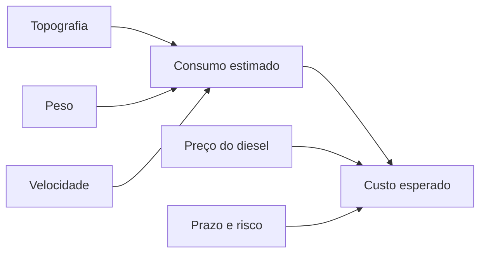
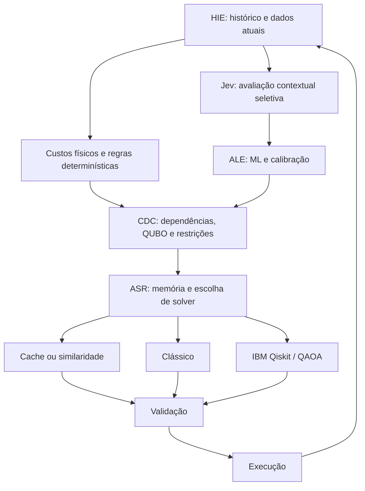

# Q-Flow — Pitch Deck v2.0
**Qiskit Fall Fest 2026 | Quantum Pitch | IBM + FIAP | 25/11/2026**

Versão textual da apresentação de 16 slides. Referências completas: [White Paper v2.0](../../releases/whitepaper_v2.0.pdf) e [Executive Summary](../../releases/executive_summary_v2.0.pdf). Os arquivos diagramados PDF/PPTX são entregáveis separados.

## 01 — Q-Flow
Inteligência logística adaptativa. Otimização híbrida quântica-clássica, IA estruturada e aprendizado contínuo. Collect. Interpret. Optimize. Learn. Repeat. Proposta conceitual; equipe a confirmar no formulário.

## 02 — A rota mais curta nem sempre custa menos
Peso remanescente, inclinação e velocidade afetam consumo; preços no ponto de abastecimento, SLA e recursos compartilhados afetam custo. Uma decisão individual pode ser pior para a frota.

## 03 — Uma camada de otimização para o TMS existente
Cliente ideal: transportadoras com rotas recorrentes, telemetria e custos relevantes de combustível. API recomenda planos de rotas, veículos, sequência, horários e abastecimento. Validar benefício incremental frente ao TMS e solucionadores clássicos. Não há mercado dimensionado ou clientes validados.

## 04 — Da telemetria à decisão validada

A operação não depende de disponibilidade da QPU. Todas as alternativas precisam de validação.

## 05 — Jev interpreta contexto; ML calibra a confiança
Choice: condição da via. Score: dificuldade de acesso. Noul: sinal de risco de atraso. Saídas são ilustrativas, não executadas na API. Custo esperado de risco = probabilidade calibrada × impacto monetário. Com penalidade de R$ 500, A = 300 + 20% × 500 = R$ 400; B = 320 + 4% × 500 = R$ 340. Probabilidade do modelo não é frequência observada sem calibração; restrições de segurança são determinísticas.

## 06 — Contextual Decision Compiler
Gerar candidatos classicamente; escolher planos por variáveis binárias. QUBO: F(x) = Σ_i c_i x_i + Σ_(i<j) q_ij x_i x_j + λ Σ_v (Σ_k x_vk − 1)^2. Termos individuais representam custos; interações representam impactos adicionais; penalidade impõe escolha única por veículo. Restrições adicionais precisam de tratamento e validação.

## 07 — Demonstração matemática
Dois caminhões; A custa R$ 300 e R$ 290, B custa R$ 320 e R$ 310. Se ambos usam A, acrescentar R$ 70. x=0 significa A; x=1 significa B.
F = 660 − 50x1 − 50x2 + 70x1x2.
| Estado | Custo |
|---|---:|
| 00 | R$ 660 |
| 01 | R$ 610 |
| 10 | R$ 610 |
| 11 | R$ 630 |
Dois ótimos exatos, economia ilustrativa de R$ 50 (7,58%). Não é vantagem quântica nem economia real de frota.

## 08 — IBM Qiskit e Ising
x_i = (I − Z_i)/2. H = 627,5 I + 7,5 Z1 + 7,5 Z2 + 17,5 Z1Z2. QAOA alterna custo e mistura, amostra bitstrings e ajusta parâmetros com otimizador clássico. Validar custo e restrições. QAOA é aproximado; não há demonstração de vantagem quântica.

## 09 — Viabilidade quântica
Mapeamento dirigido ingênuo com depósito: n(n+1) variáveis antes de veículos e auxiliares: 5 entregas → 30; 10 → 110; 20 → 420. Gerar candidatos, decompor por turno/região e testar QAOA em conflitos pequenos. Considerar ruído, conectividade, profundidade, orçamento e filas.

## 10 — Adaptive Learning Engine
Calibração com telemetria: P_calibrada = f_theta(P_Jev, X). Exemplo hipotético de previsão/frequência: serra/carga pesada 80%/62%; chuva/rodovia plana 45%/22%; trânsito urbano 60%/74%. Regressão logística, isotônica, XGBoost/LightGBM, monitoramento de drift, versionamento e rollback. Teste temporal e por cliente, erro de consumo, Brier Score e qualidade por grupo.

## 11 — Adaptive Solver Router e memória
- Cache exato: mesmas entradas, versões e validade.
- Similaridade: recuperar, validar e reparar candidatos.
- Atualização incremental: recalcular coeficientes afetados.
- Warm-start: iniciar nova otimização com informação anterior, sem garantia de ganho.
Selecionar memória, solver clássico ou Qiskit por qualidade, custo, prazo e limites de circuito. Medir reutilização válida, gap/regret, latência, chamadas Jev e custo total por decisão.

## 12 — Historical Intelligence Engine
Importar ERP/TMS/GPS → tratar → reconstruir contexto disponível antes da decisão → avaliar com Jev sem ver o desfecho → treinar com resultados reais. Maior volume não garante menor viés. Resultados de alternativas não escolhidas não são observados. Evitar data leakage; holdout e piloto controlado.

## 13 — Data Partnership
Históricos autorizados em troca de descontos de implantação ou créditos temporários. Modelos globais aprendem padrões compartilháveis; modelos privados são especializados por cliente. Data Contribution Score sugerido: 45% qualidade/completude, 40% diversidade/novidade, 15% volume útil/atualização. Validar valor marginal. LGPD, finalidade, minimização, base legal, isolamento e confidencialidade; não compartilhar GPS identificável, contratos, tarifas, margens ou rotas estratégicas por padrão. Participação global voluntária.

## 14 — Modelo comercial
Cenário ilustrativo: 100 veículos, R$ 12 mil de combustível por veículo/mês = R$ 1,2 milhão/mês. Uma redução hipotética de 3% representa R$ 432 mil/ano. Padrão: R$ 140 mil no primeiro ano (R$ 10 mil/mês + R$ 20 mil implantação); Partner: R$ 100 mil (25% desconto mensal, 50% na implantação). Saldo hipotético Partner de R$ 332 mil antes de custos adicionais. Nenhum preço ou resultado validado.

## 15 — Validação e roadmap
A: distância; B: clássico multivariável; C: Jev + ML + clássico; D/E: QAOA no mesmo QUBO de B/C; F: cache e warm-start. Comparar mesmas instâncias, restrições e orçamento; registrar gap, viabilidade, latência, custos, shots e profundidade. MVP de três veículos, 2–3 planos por veículo, carga, relevo, horários e doca. Verificados: QUBO, equivalência Ising e enumeração clássica do exemplo. Pendentes: QAOA, QPU, Jev, ML, memória, shadow mode e piloto.

## 16 — O futuro da logística é aprender a decidir
Gerar valor clássico hoje e investigar onde a computação quântica se torna competitiva.

Referências: [IBM QAOA](https://quantum.cloud.ibm.com/docs/en/tutorials/quantum-approximate-optimization-algorithm), [Qiskit Vehicle Routing](https://qiskit-community.github.io/qiskit-optimization/tutorials/07_examples_vehicle_routing.html), [Warm-starting quantum optimization](https://doi.org/10.22331/q-2021-06-17-479). Ver referências completas no White Paper.

**Declaração de uso de IA:** ChatGPT apoiou pesquisa, formulação matemática didática, diagramas, redação e revisão. Proposta conceitual, sem execução QPU ou integração Jev validada. Não representa aprovação institucional da IBM ou FIAP.
